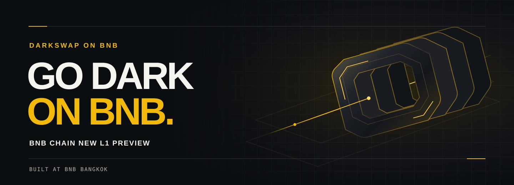

<p align="center">
  
</p>

# DarkSwap on BNB

**A trading interface for BNB Chain’s native privacy layer.** DarkSwap brings its intent-based swap experience to BNB Chain New L1. The Bangkok build reads the live shielded pool and lets judges walk through a public swap rehearsal with a capped quoting agent.

**Live demo:** [hack.darkswap.app](https://hack.darkswap.app) · [简体中文](https://hack.darkswap.app/hack/zh) · [technical page](https://hack.darkswap.app/)

[Run the demo](#run-the-demo) · [What stays public](#what-stays-public) · [HackQuest submission notes](./docs/hackquest-submission.md) · [CoinMarketCap × Atlas write-up](./docs/cmc-atlas-writeup.md)

> **BNB Bangkok hackathon preview.** Pool data comes from New L1 devnet. The rehearsal runs with public amounts and cleartext notes on a local chain. Proof-backed swap settlement is the next milestone.

## The three-minute demo

| Time | Show | What to look for |
| --- | --- | --- |
| 0:00 | **Read the live pool.** Open the homepage and find the New L1 devnet receipt. | Chain ID `1105`, the latest block, and the balance of the native ShieldedPool at `0x…5000`. |
| 0:40 | **Ask the agent for a quote.** Open the console at `/hack` or use the CLI below. Enter `0.10 BNB`, then `0.04 BNB`. | The first quote hits the **0.05 BNB** cap. The second lets you inspect the quote and any configured market decision. |
| 1:30 | **Show the market check.** With CoinMarketCap configured, compare its BNB/USD print with the demo price. | The agent can refuse a quote outside the price band. The [sponsor write-up](./docs/cmc-atlas-writeup.md) explains the API log and the local oracle tests. |
| 2:15 | **Run the public rehearsal.** Walk through shield → swap → reshield on Anvil. | Cleartext notes show the sequence. The contract guard can reject stale or divergent oracle data before spending the note. |

## What runs where

| Capability | Network or environment | Status |
| --- | --- | --- |
| ShieldedPool reads | BNB Chain New L1 devnet · `1105` | Live read-only RPC integration. Pool at `0x0000000000000000000000000000000000005000`. |
| Quote agent and spend cap | Local CLI and MCP | `quote_swap` is available over stdio and via the read-only HTTP endpoint at `/api/mcp`, live at `https://privacy-bnb.vercel.app/api/mcp`. The Python agent supports optional Claude parsing for free-form requests. |
| Swap rehearsal and oracle guard | Local Anvil · `31337` | Executable public flow with a demo AMM, cleartext notes, and a mock AggregatorV3 feed. |
| CoinMarketCap BNB/USD | CoinMarketCap Pro API | The quote checks market deviation when `CMC_API_KEY` is set. With the key unset, the market check is skipped. |
| ERC-8004 agent identity | BNB Smart Chain testnet · `97` | Registered. Agent id **2930**. Registry `0x8004A818BFB912233c491871b3d84c89A494BD9e`. Owner `0x57f37b891980616e76ED2f650e7e38BeAFd59084`. [Transaction](https://testnet.bscscan.com/tx/0xb1e4d02d93129995dfb26f1fed3f2c2ad9eeac997c8d0b9a2d889e1a564b6a00). Default RPC is `https://bsc-testnet-dataseed.bnbchain.org`. |
| Proof-backed swap | BNB Chain New L1 devnet | Documented integration path. End-to-end proof generation and settlement are pending. |

## Why DarkSwap

Shielded liquidity is fragmented across small pools, so anonymity sets stay thin and moving between them leaks.

[DefiLlama](https://defillama.com/protocols/privacy) tracks 55 privacy protocols with $763.5m TVL, about 98% in Tornado Cash, Railgun, and Zama. Zcash shielded supply is split across four pools ([Atlas ZEC](https://www.atlaszec.com/shielded.html)). On Solana, Privacy Cash is about $1.18m ([DefiLlama](https://defillama.com/protocol/privacy-cash)), and Elusiv shut down on 29 Feb 2024 ([Elusiv](https://medium.com/elusiv-privacy/sunsetting-elusiv-transitioning-towards-the-future-of-privacy-and-confidentiality-0b078e9bcfac)). 17.65% of Railgun withdrawals are linkable ([arXiv 2606.25926](https://arxiv.org/abs/2606.25926)). 95.81% of bridge withdrawals were matched from public logs ([arXiv 2409.04937](https://arxiv.org/abs/2409.04937)).

NEAR Intents has routed $41.25B across 39 chains, including BNB ([NEAR Stats](https://nearstats.org/)). New L1 says atomicCall privacy comes from "the set of other users doing the same kind of operation" ([BNB Chain docs](https://docs.bnbchain.org/newl1/core-concepts/privacy/)).

DarkSwap funnels assets from any chain, through an intent, into one BNB New L1 shielded pool, where the ERC-8004 agent swaps with atomicCall without leaving that pool. **One deep shielded pool instead of fifty shallow ones.**

That funnel is the roadmap. Deposits into the pool are public today. This repository does not submit a type 0x77 proof yet. The seed pool is about 555 rNOTE per BNB so a live CoinMarketCap print can sit inside the 500 bps band. Set `DEMO_RNOTE_PER_BNB` to change it.

**Live on New L1.** atomicCall unshields, calls public DeFi, and reshields in one transaction. [BNB's post](https://forum.bnbchain.org/t/introducing-the-new-l1-native-privacy-layer/5481) measured that at about 1,010,000 gas against a mock DEX. That call is DarkSwap's private swap step. The preview pool holds native BNB only, so the funnel lands assets as BNB notes for now. Withdrawals can never be paused by governance.

**Roadmap.** New L1 relayers are the main submission path. They pay gas, hide the user's EOA, are paid with a private fee note, and cannot change the recipient or the amount. DarkSwap's ERC-8004 agent is designed to be that relayer for a user intent. ERC20 is a reserved field on BNB's roadmap.

## What stays public

In the **intended New L1 flow**, the deposit exposes the depositor, amount and asset. The atomic call reveals the swap target, calldata and input and output amounts. The reshielded open note can keep its owner private while its amount and asset remain visible. The devnet pool currently shields native BNB. The demo’s `rNOTE` is a local test token. [New L1 shielded pool docs](https://docs.bnbchain.org/newl1/core-concepts/privacy/)

## Run the demo

**Web.** Install dependencies and start the Next.js app.

```bash
npm install
npm run dev
```

Open the hackathon console in [English](http://localhost:3000/hack) or [简体中文](http://localhost:3000/hack/zh). The [technical homepage](http://localhost:3000) shows the devnet receipt, and [the swap page](http://localhost:3000/swap) provides a stand-alone rehearsal quote. The pool read and demo quote require no wallet. See [the environment template](./.env.example) for optional RPC and market-data settings. The site can be deployed to Vercel with the repo root and Next.js preset.

**Agent.** Try an over-cap request and an under-cap quote.

```bash
cd agent
PYTHONPATH=. python3 -m darkswap_agent quote "swap 0.1 bnb to rNOTE privately"
PYTHONPATH=. python3 -m darkswap_agent quote "swap 0.04 bnb to rNOTE privately"
```

The over-cap command returns a refusal and exits with status 1. The under-cap command quotes without broadcasting. See the [agent guide](./agent/README.md) for MCP, optional model-based parsing, ERC-8004 registration and local execution.

**Contracts.** From the repo root, use Foundry to run the rehearsal tests and read the devnet pool.

```bash
cd contracts
forge test
./script/probe-devnet.sh
```

See the [contract guide](./contracts/README.md) for the full Anvil walkthrough, local addresses and testnet configuration.

## Built at BNB Bangkok

This build extends the work behind [DarkSwap](https://darkswap.app/), which starts swaps on Solana and routes them through NEAR Intents. The Bangkok work adds New L1 pool reads, a public swap rehearsal, capped agent quotes and price guards. The next milestone is a proof-backed native BNB flow on New L1.

[BNB Bangkok on HackQuest](https://www.hackquest.io/hackathons/BNB-Bangkok) · [Demo Night](https://luma.com/5topfryz) · [BNB Chain New L1 docs](https://docs.bnbchain.org/newl1/overview/) · [@darkswapapp](https://x.com/darkswapapp)
